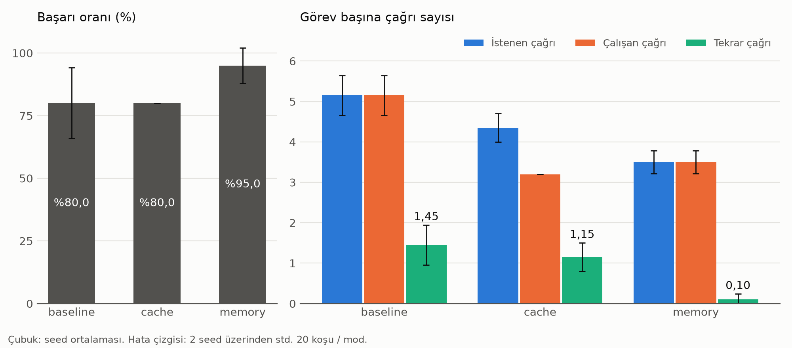

# Agent'larda gereksiz tool çağrılarını azaltmak

AIRLAB üye alım görevi, Alan 5 (Agentic AI). Ayşenur Solmaz.

Bir tool-calling agent'ı 10 görevle koştum ve gereksiz tool çağrılarını ölçtüm. Sonra iki müdahale ekledim: cache ve kısa dönem hafıza. Aynı görevleri yeniden koşup çağrı sayısının başarıyı düşürmeden azalıp azalmadığına baktım.

## Sonuçlar

60 koşunun hepsi tamamlandı, API hatası olmadı. Değerler görev başına ortalamadır: 2 seed üzerinden ortalama ± örneklem std'si.

| Mod | Başarı | İstenen çağrı | Çalışan çağrı | Tekrar çağrı | Adım | Token |
|---|---|---|---|---|---|---|
| `baseline` | %80,0 ± 14,1 (16 / 20) | 5,15 ± 0,49 | 5,15 ± 0,49 | 1,45 ± 0,49 | 6,00 ± 0,42 | 5486 ± 331 |
| `cache` | %80,0 ± 0,0 (16 / 20) | 4,35 ± 0,35 | 3,20 ± 0,00 | 1,15 ± 0,35 | 5,25 ± 0,35 | 4810 ± 416 |
| `memory` | %95,0 ± 7,1 (19 / 20) | 3,50 ± 0,28 | 3,50 ± 0,28 | 0,10 ± 0,14 | 4,50 ± 0,28 | 4763 ± 551 |



- **`memory` işe yaradı.** Tekrar çağrı %93,1, istenen çağrı %32,0 azaldı, başarı düşmedi. Tekrar tetikleyen görev 8'i 2 / 2 çözdü, `baseline` ve `cache` 0 / 2'de kaldı.
- **`cache` tool maliyetini azalttı, modelin davranışını değiştirmedi.** Çalışan çağrı %37,9 azaldı, başarı aynı kaldı. Tekrar tetikleyen görevlerde model aynı çağrıları istemeye devam etti: istenen çağrı 13,00'dan 12,25'e indi, tekrar 5,50'den 5,75'e çıktı.
- **Görev 7'deki sorunu hiçbir müdahale düzeltmedi.** Üç modun hepsinde, toplam 4 koşuda, model hiç tool çağırmadan "bu bilgi yok" diye cevap verdi. `memory`'nin tek başarısızlığı da bu görevde.
- **Sürede anlamlı fark yok.** Medyan süre 3,68 / 3,08 / 3,73 sn. Tool'lar sahte olduğu için süreyi çoğunlukla API gecikmesi belirliyor.

Tekrar tetikleyen ve diğer görevlerin ayrı tabloları, baseline'a göre yüzde değişimler ve görev bazında sonuçlar [results/summary.md](results/summary.md) dosyasında.

**Önceki koşuyla aynı yön.** 3 seed'lik ilk koşuda (90 koşu) başarı `baseline` / `cache` / `memory` için 25 / 30, 25 / 30 ve 30 / 30, tekrar çağrı 1,19 / 1,09 / 0,00 idi. O koşuda da `memory` en iyisiydi ve `cache` sadece çalışan çağrıyı azaltmıştı.

## Deney

### Senaryo ve tool'lar

Agent, kurgusal bir kitabevi zinciri olan Kuzey Kitabevi'nin çalışanına yardım eder. Veriler kurgusal olduğu için model cevabı ezberden veremez, tool çağırmak zorundadır. Bütün veriler [SENARYO.md](SENARYO.md) dosyasında.

| Tool | Ne yapar |
|---|---|
| `database` | 4 tablodan eşitlik filtresiyle okur, yazma yoktur |
| `web_search` | 8 kayıtlık sabit bir bilgi tabanında anahtar kelimeyle arar |
| `calculator` | `ast` ile aritmetik hesaplar, `eval` kullanmaz |

Tool'lar deterministiktir: aynı girdi her zaman aynı çıktıyı verir. Bu yüzden bir tekrar çağrı hiçbir yeni bilgi getirmez.

### Gereksiz çağrının tanımı

**Gereksiz çağrı:** Aynı görevde, aynı tool'a, normalize edilmiş aynı argümanlarla yapılan ikinci ve sonraki çağrılardır.

Normalizasyon Türkçe küçük harfe çevirir, fazla boşlukları temizler, anahtarları sıralar ve boş filtreyi atar. Örneğin `1` ile `"1"` aynı sayılır. `calculator` ifadesinde boşluklar tamamen silinir. `1` ile `1.0`, `Kadıköy` ile `Kadikoy` ise bilerek farklı sayılır. Kararların nedenleri [DESIGN.md](DESIGN.md) dosyasında.

### Metrikler

| Metrik | Anlamı |
|---|---|
| Başarı oranı | Görevin beklediği bütün sayılar son cevapta geçiyor mu ([evaluate.py](evaluate.py)) |
| İstenen çağrı | Modelin istediği tool çağrısı sayısı |
| Çalışan çağrı | Tool'un gerçekten çalıştığı çağrı sayısı |
| Tekrar çağrı | Tanıma uyan gereksiz çağrı sayısı |
| Adım | Modele yapılan istek sayısı |
| Token | Prompt ve cevap token'larının toplamı |
| Süre | Rate limit beklemeleri ve başarısız denemeler çıkarılmış süre, medyan olarak raporlanır |

Başarı oranı görevin çözülüp çözülmediğini, istenen ve çalışan çağrı ayrımı ise bir müdahalenin modelin davranışını mı yoksa sadece tool maliyetini mi azalttığını gösterdiği için bu metrikler seçildi.

### Konfigürasyonlar

| Mod | Ne değişiyor | Beklenti |
|---|---|---|
| `baseline` | Müdahale yok. Agent sadece son 4 turn'ü görür | Eski sonuçları unutup aynı çağrıları yineler |
| `cache` | Aynı anahtarlı çağrıda tool çalışmaz, sonuç cache'ten döner | Çalışan çağrı azalır, istenen çağrı azalmaz |
| `memory` | Görevdeki bütün tool sonuçları system mesajında tutulur | Model sonucu gördüğü için istenen çağrı da azalır |

Üç modda da hafıza penceresi aynıdır. Cache ve hafıza her görevin başında sıfırlanır.

### Görevler

10 görev [tasks.py](tasks.py) dosyasında.

| Görev | Tip |
|---|---|
| 1, 2 | Tek bilgi |
| 3 | İki kaynağı bağlama |
| 4 | Kur çevirme |
| 5 | Zam hesabı |
| 6 | Sıfır stok |
| 7 | Arama ve hesap |
| 8, 9 | **Tekrar tetikleyici:** aynı bilgi iki kez gerekir |
| 10 | Cevabı olmayan soru |

Tekrarı iki şey tetikler: görev 8 ve 9 aynı bilgiyi iki kez gerektirir, agent da sadece son 4 turn'ü görür.

### Ayarlar

- **Model:** `openai/gpt-oss-120b` (Groq), sıcaklık 0.6
- **Hafıza penceresi:** 4 turn
- **Adım sınırı:** 15
- **Seed:** 0, 1
- **Toplam:** 3 mod × 10 görev × 2 seed = 60 koşu

Sonuçlar seed ortalamalarının ortalaması ± örneklem standart sapmasıdır.

API hatası veren koşu başarısız sayılır. Bu koşuların çağrı sayıları kayıtlı olmadığı için, çağrı karşılaştırmasında o görev-seed çifti üç moddan da çıkarılır. Böylece modlar aynı görevler üzerinden karşılaştırılır.

## Yorum

**Beklenti.** `cache`'in çalışan çağrıyı azaltıp istenen çağrıyı değiştirmemesini, `memory`'nin ise sonuçları gösterdiği için istenen çağrıyı da azaltmasını bekliyordum.

**Sonuç.** İkisi de beklendiği gibi çıktı. `cache` çalışan çağrıyı azalttı ama görev 8'i bitiremedi, çünkü model aynı çağrıları istemeye devam etti. `memory` tekrarı neredeyse sıfırladı (1,45 → 0,10) ve başarıyı düşürmedi (%80 → %95).

**Farkın olası nedenleri.** `cache` modelin gördüğü mesajları değiştirmez: tool'lar deterministik olduğu için cache'ten dönen sonuç, tool'un vereceği sonucun aynısıdır. Sonuç 4 turn'lük pencereden çıkınca model onu unutur ve aynı çağrıyı yine ister. `memory` ise sonuçları system mesajında tuttuğu için model onları pencere dolsa da görür. `cache`'te istenen çağrının %15,5 düşmesi bu yüzden müdahalenin etkisi değil, rastgeleliktir. Farkın çoğu görev 4'ten gelir: model bazen 5-6, bazen 10-11 çağrılık yolu seçer. İkinci koşuda uzun yolu `cache` seçmişti.

**Sonraki adım.** Önce görev 7 için system prompt'a "cevap vermeden önce tool'ları dene" kuralı ekleyip bunu ayrı bir konfigürasyon olarak ölçerdim. Sonra `cache` ve `memory`'yi birlikte denerdim: `memory` istenen çağrıyı, `cache` kalan tekrarların maliyetini azaltır. Son olarak daha fazla seed ve ikinci bir modelle sonucun genellenip genellenmediğine bakardım.

## Sınırlamalar

- **Tekrar sayısı bir alt sınırdır.** Eşleşme anlama değil, argümanlara bakar. `filtre: {}` ile tüm tabloyu çekip sonra `{"ad": "Kadıköy"}` ile aynı bilgiyi almak tekrar sayılmaz.
- **Pencere ve adım sınırı pilotlarla seçildi.** Pencere 2'de görevler imkânsız oluyordu, bu yüzden 4'e çıkarıldı. Görev 8 en az 7-8 çağrı gerektirdiği için adım sınırı 10'dan 15'e çıkarıldı. Yani bu değerler bağımsız ayarlar değildir ([DESIGN.md](DESIGN.md), bölüm 8).
- **Tekrarların çoğu 2 görevden geliyor.** `baseline`'daki 29 tekrarın 22'si görev 8 ve 9'da, 7'si görev 4'te. Sonuç bütün agent görevlerine genellenemez.
- **Örneklem küçük.** Her konfigürasyon 2 seed ile koşuldu ve tek model denendi. `memory` ile `baseline` arasındaki başarı farkı 3 koşu. İki değerden hesaplanan std zayıf bir ölçüdür. Model aynı seed'le birebir aynı cevabı vermez.
- **Model rastgele yol seçer.** Görev 4'te model bazen 5-6, bazen 10-11 çağrı istiyor. Bu yüzden küçük farklar, örneğin `cache`'in istenen çağrıdaki %15,5'lik düşüşü, müdahaleye bağlanmamalı.
- **Adım sınırı çağrı sayısını keser.** 5 koşu (`baseline` 3, `cache` 2) 15 adımda kesildi. Bu koşuların gerçek çağrı sayısı daha yüksek olabilirdi, yani `memory`'nin sağladığı azalma olduğundan küçük görünüyor olabilir.
- **Başarı kontrolü basittir.** Sayıların cevapta geçtiğine bakar, doğru bağlamda olup olmadıklarına bakmaz.
- **Tool'lar mock'tur.** Gerçek gecikmeleri yoktur, bu yüzden çalışan çağrı azalsa da süre buna göre değişmez. Süre daha çok API gecikmesine bağlıdır.

## İlk koşu ve düzeltmeler

Deney üç kez başlatıldı. Rapordaki ana sonuç `results/results_v3.jsonl` dosyasıdır ve bu seçim yeni sonuçlar görülmeden yapıldı.

Plan 3 seed idi. Groq'un günlük 200.000 token limiti yüzünden bitiş saati belirsizleşince ikinci koşuda hedef 2 seed'e (60 koşu) indirildi. Alım görevi her konfigürasyonun 2-3 kez koşulmasını istediği için 2 seed yeterlidir.

İkinci koşu ([results/results_v2.jsonl](results/results_v2.jsonl)) 52 / 60'ta Wi-Fi kopunca durdu, araya bilgisayarın bekleme modu da girmişti. Kaldığı yerden devam etmek yerine aynı 60 koşu baştan başlatıldı. Bu koşunun sonuçları karar verilirken görülmüştü, bu yüzden silinmedi ve karşılaştırma için repoda duruyor.

3 seed'lik ilk koşuda ([results/results.jsonl](results/results.jsonl), 90 koşu) şu düzeltmeler deney sürerken yapılmıştı:

- `web_search` görev 7'nin "paket gönderim" gibi sorgularını bulamıyordu, anahtar kelimeler eklendi ve görev 7 yeniden koşuldu.
- Puanlama "bulunmadığı" kelimesini tanımıyordu, düzeltildi ve kayıtlı cevaplar yeniden puanlandı.
- Rate limit beklemesi ve bağlantı kopması koşuyu durduruyordu, bekleme ve tekrar deneme eklendi.
- Birkaç koşunun süresi agent dışı bir duraklamayla şişti (en uzunu 4 adımda 56.445 sn).

Son koşuda bütün satırlar aynı kodla üretildi, deney sırasında kod değişmedi. Bağlantı kopması ve bekleme süresi ölçüme yazılmaz. Bir kez pil bittiği için bilgisayar 41 dakika uyudu (görev 8, `cache`, seed 1). Bu koşunun süresi 34,3 sn ile normal aralıkta kaldığı için yeniden koşulmadı. Önceki koşular silinmedi.

## Çalıştırma

Python 3.12 ve [uv](https://docs.astral.sh/uv/) gerekir. `pip` ile kurmak için `requirements.txt` da vardır.

```bash
uv sync
```

```bash
cp .env.example .env
```

`.env` dosyasına Groq anahtarını yaz. Sonra testleri çalıştır (anahtar gerektirmez):

```bash
uv run python -m unittest test_analyze test_experiments test_tasks test_tools test_agent
```

Deneyi koş. Yarıda kesilirse aynı komut kaldığı yerden devam eder:

```bash
uv run python run_experiments.py
```

Tabloları ve grafiği üret (API çağrısı yapmaz):

```bash
uv run python analyze.py
```

## Dosyalar

| Dosya | İçerik |
|---|---|
| [tools.py](tools.py) | Mock tool'lar ve normalizasyon |
| [agent.py](agent.py) | Agent döngüsü, cache, hafıza |
| [tasks.py](tasks.py) | 10 görev ve doğru cevaplar |
| [evaluate.py](evaluate.py) | Otomatik başarı kontrolü |
| [run_experiments.py](run_experiments.py) | Deney koşturucu |
| [analyze.py](analyze.py) | Tablolar ve grafik |
| [DESIGN.md](DESIGN.md) | Tasarım kararları ve nedenleri |
| [SENARYO.md](SENARYO.md) | Kurgusal veriler |
| `results/results_v3.jsonl` | Ana sonuç: 60 koşunun ham kaydı |
| `results/results_v2.jsonl` | İkinci koşu, 52 / 60'ta yarım kaldı |
| `results/summary.md`, `results/modlar.png` | Üretilen tablolar ve grafik |
| `results/results.jsonl` | İlk koşu |
| `results/results_v1_before_fixes.jsonl` | İlk koşunun düzeltmelerden önceki arşivi |
| `results/pilot.jsonl`, `results/pilot_w4.jsonl` | Pencere ve adım sınırı pilotları |
